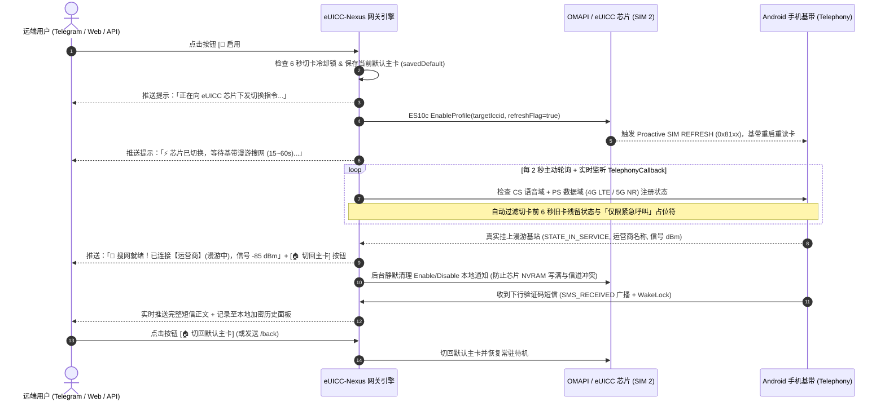

# eUICC-Nexus

<p align="center">
  <b>基于 Android 备用机的远程多国 eSIM (eUICC) 切卡、基带漫游监控与短信/验证码自动化网关</b><br/>
  <i>Remote Multi-Profile eUICC Switching, Baseband Roaming Monitor & SMS/OTP Relay Gateway for Android</i>
</p>

<p align="center">
  <a href="LICENSE"></a>
  <a href="https://github.com/iebb/NekokoLPA2"></a>
  
  
  <a href="https://linux.do"></a>
</p>

---

> ### 📜 开源衍生与商标合规声明 (Upstream Attribution & Notice)
> - **上游致谢**：本项目 **eUICC-Nexus** 基于开源项目 **[iebb/NekokoLPA2](https://github.com/iebb/NekokoLPA2)**（及其伴生组件 [iebb/OTBridge](https://github.com/iebb/OTBridge)、[iebb/remocard](https://github.com/iebb/remocard)）进行二次开发与网关化扩展，完整保留并遵循 **[MIT License](LICENSE)** 开源许可证。
> - **设计启发**：远程网关交互与保号工作流的设计同时汲取了社区开源项目 [cyDione/eSIM-SMS-Forwarder](https://github.com/cyDione/eSIM-SMS-Forwarder) 与 [pppscn/SmsForwarder](https://github.com/pppscn/SmsForwarder) 的优秀思路，特此致谢。
> - **社区支持与友链**：感谢 **[LINUX DO 社区 (linux.do)](https://linux.do)** 佬友们的交流与支持。
> - **独立性与合法合规声明**：`NekokoLPA` 是 `SIMLINK LTD.` 的注册商标。本项目（**eUICC-Nexus**）由第三方独立开发维护，**并非 NekokoLPA 官方产品**（详见 [`NOTICE`](NOTICE) 与 [`BRANDING.md`](BRANDING.md)）。本项目仅供个人开发者管理自有合法持有的 eSIM 卡片（代码不含远程拨号与 `SEND_SMS` 发信功能），严禁用于非法接码平台、电信网络诈骗或未经授权的他人设备监控。

---

## 一、痛点背景与项目定位 (Why eUICC-Nexus?)

跨境开发者与极客通常持有可插拔实体 eUICC 芯片（如 **9eSIM / ESTKme / esim.gg / SakuraSIM** 等），在单张物理芯片内写入多个国家的 eSIM Profile（如英国 `+44`、美国 `+1`、爱沙尼亚 `+372`、香港 `+852`），并将其插在一台常年通电挂机的闲置 Android 备用机上。

然而受限于 **GSMA SGP.22** 标准，**单张 eUICC 同一时刻只能启用（Enable）1 个 Profile 注册基站收发短信**。现有社区方案存在明显断层：

| 方案维度 | 传统短信转发器 (`SmsForwarder`) | 原版 LPA (`NekokoLPA 2` / `OpenEUICC`) | 随身 WiFi 方案 (`eSIM-SMS-Forwarder`) | **eUICC-Nexus (本项目 v1.0)** |
| :--- | :---: | :---: | :---: | :---: |
| **运行载体** | Android 手机 | Android / 跨平台客户端 | 仅限特定 Debian 随身 WiFi 棒 | **任意闲置 Android 手机** |
| **本地 eSIM 写卡/切卡/删卡** | ❌ 不支持 | ✅ 支持 (需手动打开 App 操作) | ✅ 依赖 Linux `lpac` | **✅ 原生内置 (复用 NekokoLPA 2 引擎)** |
| **Telegram Bot 远程切卡/下卡/删卡** | ❌ 不支持 | ❌ 不支持 | ⚠️ 仅通知推送 | **✅ 全流程可视化内联按钮 + 原生菜单** |
| **4G/5G 漫游基站注册就绪感知** | ❌ 不支持 | ❌ 切完卡无基带搜网闭环反馈 | ✅ 依赖 `ModemManager` | **✅ CS+PS 双域监听 + 假在线过滤 + 信号主动回报** |
| **高频切卡芯片 NVRAM 垃圾通知自洁** | — | ⚠️ 默认联网上报易引发信道碰撞 | ❌ 无自动清理 | **✅ 切卡后本地 10 字节 APDU 静默秒清** |
| **短信/OTP 实时截获转发 + 历史记录** | ✅ 支持 | ❌ 不支持 | ✅ 支持 | **✅ 原生广播截获 + Keystore 加密 + 历史面板** |
| **局域网 / Tailscale Web 面板与 REST API** | ⚠️ 仅转发配置 | ❌ 不支持 | ✅ 支持 (`:8080`) | **✅ 内置暗色 Web 控制台与 REST API (`:8787`)** |

**eUICC-Nexus 的核心价值**：不重复造底层 ASN.1 / APDU 轮子，直接在 Android 备用机上打通 **「远程指令切卡 / 下卡 / 删卡 ➔ 4G/5G 漫游基站握手状态机监控 ➔ 搜网就绪主动通知 ➔ 短信/OTP 实时截获推送 ➔ 一键回滚默认主卡」** 的完整无人值守闭环。

---

## 二、核心架构与状态机闭环 (Architecture & State Machine)



---

## 三、核心功能亮点 (Key Features)

### 1. 🤖 Telegram Bot 全按钮交互式主控台（告别手敲繁琐命令）
- **左下角原生命令菜单 (`setMyCommands`)**：连接成功后自动向 Telegram / AyuGram 等客户端注册 `/list`、`/status`、`/keepalive`、`/readers`、`/rename`、`/use`、`/use_temp`、`/back`、`/default`、`/download_test`、`/download`、`/delete`、`/retry_sms`、`/help` 快捷菜单。
- **全流程内联按钮 (`Inline Keyboard` + `callback_query` 回调)**：
  - **卡内列表 (`/list` 含芯片剩余 KB 空间与 EID)**：顶部直接展示当前 eUICC **芯片剩余可用空间（如 `277.3 KB`）** 与 **EID**；每张未启用卡片下方直接生成 **`[ 🔄 启用 #序号 ]`**（持久切卡）、**`[ ⏱️ 5分接码 #序号 ]`**（5 分钟后自动切回默认主卡）与 **`[ 🗑️ 删 #序号 ]`** 按钮；当前激活卡下方生成 **`[ 📌 设为主卡 ]`** 与 **`[ ✏️ 改名 ]`** 按钮。
  - **直接发送 eSIM 二维码图片或粘贴 `LPA:1$...` 远程下卡**：无需手动扫码转文字，直接在 Telegram 聊天框发送 **eSIM 二维码截图/照片**（或粘贴 `LPA:1$smdp地址$匹配码`），机器人自动在内存中识别解码二维码并执行 ES9+/ES10b 远程写卡。
  - **远程修改卡片备注名 (`/rename`) 与多卡槽切换 (`/readers`)**：支持在 Telegram 直接发送 `/rename 2 英国主力 +44` 修改卡片昵称，或点击 **`[ 🔀 切换卡槽/读卡器 ]`** 在 `SIM 1`、`SIM 2` 与外置读卡器间无缝切换。
  - **定时自动轮巡保号引擎 (`/keepalive`)**：可为任意跨国卡片设置周期性保号任务（如每 90 天自动切换并驻留漫游基站 3 分钟，汇报信号后自动切回默认主卡），也支持一键 **`[ ⚡ 立即保号 ]`**。
  - **一键二步安全删卡 & 内置 Speedtest 公开测试 eSIM**：点击 **`[ 🗑️ 删 #序号 ]`** 弹出高危确认框（当前激活卡与默认主卡受防误删保护）；内置 `LPA:1$rsp.truphone.com$QRF-SPEEDTEST` 一键下载测试按钮。
### 2. 📡 专为跨国漫游调校的 Android 4G/5G 基带状态机
- **CS + PS 双域识别**：许多跨国纯流量/漫游 eSIM（如 Saily `+1`、esim.gg、乌龟卡等）在国内漫游时仅注册在 **4G LTE / 5G NR 数据域 (`DOMAIN_PS`)** 而不开通传统 CS 语音域。`NetworkStatusPlugin` 同时读取 `ServiceState`、`NetworkRegistrationInfo` (`DOMAIN_CS` / `DOMAIN_PS`) 与 `dataNetworkType`，精准识别漫游挂网状态。
- **防假在线与防「仅限紧急呼叫」误判**：切卡瞬间手机基带尚未完成 SIM 复位时，系统往往会残留旧卡状态或将“仅限紧急呼叫 (`Emergency calls only`)”误报为在线。状态机内置 6 秒基带硬件复位窗口与占位运营商名称过滤器，确保只有**新卡真正挂上基站**后才推送 `📡 搜网就绪！`。

### 3. 🛡️ eUICC 芯片 NVRAM 保护与防 APDU 信道碰撞 (`TRANSMIT_FAILED`)
- **为什么原版频繁切卡容易报 `TRANSMIT_FAILED` 或写满芯片？**
  根据 GSMA SGP.22 标准，每次切换卡片都会在 eUICC 芯片 NVRAM 内产生 `Enable` + `Disable` 两条通知。如果切卡后立即打开 OMAPI 通道读取几千字节的签名证书去联网上报 SM-DP+，极易与手机基带正在执行的 `SIM REFRESH` 抢占同一物理读卡器通道，导致 `TRANSMIT_FAILED`；而如果不清理通知，约切换百余次就会耗尽芯片的 `300 KB` 闪存空间。
- **本项目的两全方案**：
  - **Enable / Disable 通知**：在卡片切换完成且基带稳定后，后台自动发送单条 10 字节 `NotificationSent` APDU（耗时 `<100ms`，无需联网）将切卡通知直接从芯片闪存抹除，**芯片可用空间永久保持初始值，且切卡零碰撞**；
  - **Delete（删卡）通知**：删卡后自动在后台上报原运营商 SM-DP+ 服务器并清理芯片通知，确保运营商释放你的 eSIM 换机重下配额。

### 4. 💬 验证码智能提取（单击复制）、离线重试队列、来电提醒与宿主机健康告警
- **OTP 验证码智能提取 + Telegram 单击复制 (`<code>OTP</code>`)**：收到多国验证码短信时，自动正则提取 4~8 位数字或 `G-xxxxxx` 验证码置顶显示，并以 HTML `<code>` 标签包裹（在 Telegram 中**手指轻点一下验证码数字即可直接复制**），消息底部直接附带 **`[ 🏠 已收到码，切回主卡 ]`** 按钮。
- **离线重发队列 (`Retry Queue`) + 呼入来电提醒 (`CallRelayReceiver`)**：网络抖动导致推送失败时自动按指数退避重试，并在网络恢复后自动补发（或发送 `/retry_sms` 手动补发）；同时支持截获呼入电话振铃状态 (`PHONE_STATE`) 并实时推送来电提醒到 Telegram / Webhook。
- **备用机宿主机电量 / 断电 / 高温主动告警**：`/status` 实时显示备用机电量百分比、充电电源类型 (`AC/USB`)、电池温度 (`°C`) 与网络类型；当检测到**外部充电器意外断开**、**电量低于 20%** 或 **电池温度超过 45°C** 时，自动向 Telegram 发送告警通知。
- **Android Keystore 硬件加密与本地历史面板**：凭据全部通过硬件 Keystore (`AES/GCM/NoPadding`) 加密存储；App 内置最近 100 条历史记录面板（含一键复制验证码按钮、失败重发按钮、单条删除与一键清空）。
---

## 四、快速上手指南 (Quick Start)

### 1. 环境准备
1. 将写好 eSIM Profile（或待写卡）的实体可插拔 eUICC 芯片（如 9eSIM / ESTKme 等，支持社区 ARA-M 签名或配合 Root `OTBridge`）插入 Android 备用机卡槽（推荐 `SIM 2`）。
2. 安装本仓库 Releases 中的 `eUICC-Nexus-Multi.apk`。
3. 首次打开 App：
   - 在 **「管理」** 页选择你的 eUICC 所在卡槽（如 `SIM 2`），确认能正常读取卡内 Profile 列表；
   - 切换到 **「网络」** 与 **「短信转发」** 页，按提示授予 `READ_PHONE_STATE`（电话状态）、`RECEIVE_SMS`（接收短信）与 `POST_NOTIFICATIONS`（通知）权限，并在系统设置中将本应用设为**「无限制 / 允许后台高耗电 / 锁定后台任务」**。

### 2. 配置 Telegram Bot 远程控制与短信转发
1. 在 Telegram 中私聊 [`@BotFather`](https://t.me/BotFather) 发送 `/newbot` 创建一个属于你自己的机器人，获取形如 `123456789:AAH...` 的 **Bot Token**。
2. 在 Telegram / AyuGram 中打开你刚创建的机器人，点击 **Start (`/start`)** 发送一条消息。
3. 打开手机上的 **eUICC-Nexus ->「短信转发」页**：
   - 选择 **Telegram Bot** 模式，粘贴你的 **Bot Token**；
   - 点击 **「自动发现私聊 ID」**（或手动填入你的数字 Chat ID）；
   - 打开 **「启用短信转发与远程网关」** 开关，点击 **「保存配置」**，再点 **「发送测试消息」**。
4. 此时你的 Telegram 机器人即可收到测试消息，并自动加载左下角 **`☰ 菜单`** 与可视化控制面板！

---

## 五、Telegram Bot 指令与交互一览

你既可以直接点击机器人消息下方的 **可视化内联按钮**，也可以随时发送以下指令：

| 指令 / 按钮 | 功能说明 |
| :--- | :--- |
| `/start` 或 `/help` | 打开交互式主控台面板（含网关状态与全功能快捷按钮矩阵） |
| `/list` | 查看卡内所有 eSIM 列表、**芯片剩余空间 (KB)**、**EID**，并生成 **`[ 🔄 启用 ]`**、**`[ ⏱️ 5分接码 ]`**、**`[ 🗑️ 删 ]`**、**`[ ✏️ 改名 ]`** 按钮 |
| `/status` | 实时查看当前激活卡、基带注册与漫游信号 (`dBm`)、**备用机电量/充电/温度状态** 及 **芯片剩余空间** |
| `/use <序号/名称>` | 持久切换到指定卡片并启动基带漫游搜网监控（例：`/use 2`） |
| `/use_temp <序号/名称>` | **临时接码模式**：切换到目标卡 5 分钟，倒计时结束后自动切回默认主卡（例：`/use_temp 2`） |
| `/keepalive` | 打开**定时自动切卡保号管理面板**（支持一键设置每 90 天自动保号、自定义天数 `/keepalive 2 60` 或立即驻网 3 分钟保号） |
| `/rename <序号> <新名称>` | 远程修改卡片备注昵称（例：`/rename 2 英国主力 +44`） |
| `/readers` | 查看并切换手机上的物理卡槽或外置读卡器（如 `SIM 1 ⇄ SIM 2`） |
| `/default` / `/back` | 将当前激活卡设为「默认主卡」 / 立即切回「默认主卡」 |
| **直接发送二维码图片** 或 `/download` | 直接在聊天框发送 **eSIM 二维码图片** 或粘贴 `LPA:1$smdp地址$匹配码` 远程下卡 |
| `/download_test` | 一键远程下载安装公开的 Speedtest 测试 eSIM (`LPA:1$rsp.truphone.com$QRF-SPEEDTEST`) |
| `/delete <序号/名称>` | 发起二步安全删卡（弹出确认按钮，删除后自动向 SM-DP+ 上报释放配额） |
| `/retry_sms` | 一键补发本地历史记录中未送达的短信 |
---

## 六、局域网 / Tailscale Web 面板与 HTTP REST API

当短信转发与远程网关开启后，手机会在本机 **`8787`** 端口启动轻量级暗色系 Web 控制台与 REST API（建议配合 **Tailscale / ZeroTier** 在内网安全访问）：

- **Web 控制台地址**：`http://<手机局域网或Tailscale_IP>:8787/`
- **鉴权方式**：在 App「短信转发 -> 远程控制中心」点击「生成/重置 API Token」，请求时携带 `Authorization: Bearer <API_TOKEN>`。

```bash
# 1. 查询当前网关与基带状态
curl -H "Authorization: Bearer <API_TOKEN>" http://<IP>:8787/api/v1/status

# 2. 列出卡内所有 eSIM Profile
curl -H "Authorization: Bearer <API_TOKEN>" http://<IP>:8787/api/v1/profiles

# 3. 远程切换卡片 (支持别名或 ICCID)
curl -X POST -H "Authorization: Bearer <API_TOKEN>" -H "Content-Type: application/json" \
  -d '{"profile":"BetterRoaming"}' http://<IP>:8787/api/v1/switch

# 4. 远程下载安装新 eSIM
curl -X POST -H "Authorization: Bearer <API_TOKEN>" -H "Content-Type: application/json" \
  -d '{"activationCode":"LPA:1$rsp.truphone.com$QRF-SPEEDTEST"}' http://<IP>:8787/api/v1/download

# 5. 一键切回默认主卡
curl -X POST -H "Authorization: Bearer <API_TOKEN>" http://<IP>:8787/api/v1/revert
```

---

## 七、从源码构建 (Build from Source)

### 环境要求
- Flutter SDK `>= 3.27.0` (推荐 `3.47.x`)
- JDK `17`
- Android SDK (`compileSdk 36`, Build-Tools `36.0.0`)

### 构建命令
```bash
# 1. 运行单元测试
flutter test --no-pub \
  test/services/remote_gateway_service_test.dart \
  test/services/sms_relay_service_test.dart \
  test/services/network_status_service_test.dart \
  test/services/notification_processing_test.dart \
  test/version_matches_pubspec_test.dart

# 2. 构建 eUICC-Nexus Multi (m) 变体 APK
flutter build apk --debug --flavor m --dart-define=APP_VARIANT=m --target-platform android-arm64,android-x64 --no-pub
```

---

## 八、开源协议与致谢 (License & Credits)

本项目基于 **[MIT License](LICENSE)** 开源发布。

- **上游核心项目**：[iebb/NekokoLPA2](https://github.com/iebb/NekokoLPA2)、[iebb/OTBridge](https://github.com/iebb/OTBridge)、[iebb/remocard](https://github.com/iebb/remocard) — 提供了跨平台 SGP.22 eUICC LPA 协议栈、OMAPI 通道管理与 Android Root 桥接基础（`Copyright (c) 2024-2026 Nekoko`）。
- **设计参考与致谢**：
  - [cyDione/eSIM-SMS-Forwarder](https://github.com/cyDione/eSIM-SMS-Forwarder)（Debian 随身 WiFi eSIM 切卡与短信转发控制台）
  - [pppscn/SmsForwarder](https://github.com/pppscn/SmsForwarder)（Android 短信转发器）
  - [OpenEUICC / lpac](https://github.com/estkme-group/lpac)（开源 eUICC 生态探索）
- **社区认可与友链**：
  - **[LINUX DO (https://linux.do)](https://linux.do)** — 新的理想型技术社区
- **商标与美术作品说明**：
  - `NekokoLPA` 是 `SIMLINK LTD.` 的注册商标。本项目为独立第三方开源衍生项目，非 NekokoLPA 官方产品。
  - 原仓库中包含的猫咪吉祥物美术作品由 `@sanzennami` 创作，其使用规则详见 [`NOTICE`](NOTICE) 与 [`BRANDING.md`](BRANDING.md)。
