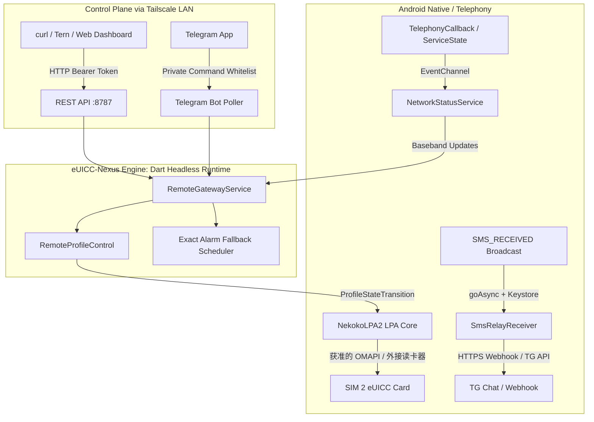
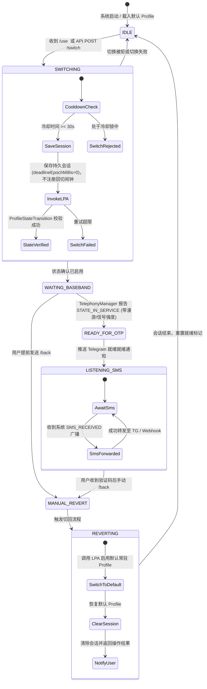

# eUICC-Nexus 架构设计与技术规范 (design.md)

## 1. 项目背景与设计目标

当前方案是在普通、非 Root Android 备用机上运行 `m`（Multi）APK；不要求 KernelSU、Magisk、OTBridge 或 LSPosed。SIM 2 可安装实体可插拔 eUICC 芯片（如 ESTKme / 9eSIM / esim.gg），内部预存多国漫游 eSIM Profile。切卡复用现有 LPA，通过卡片／固件已授权的 OMAPI 或外接读卡器访问；三签名不保证任意卡或固件放行，尚未在目标手机实测的能力不能视为已支持。

单卡槽非 MEP 场景同一时刻只能激活一个 Profile。目标是在普通应用权限下提供远程指令、基带状态监听与短信转发；`m` 的持久选卡会话需用户 `/back` 或停止网关才返回默认卡。网络状态与短信接收使用运行时权限，不以 Root 桥接作为前提。只有底层读卡器已获访问授权时，才能执行 Profile 操作。

---

## 2. 历史技术路线评估（不是当前非 Root 部署步骤）

以下保留初期 Root 候选方案的比较；当前非 Root 交付不采用其中的 OTBridge、Root Shell 或 Hook 路线，也不要求安装其模块。复用既有 LPA 不等于必须使用 Root：卡片和系统允许的本地 OMAPI，以及获准的外接读卡器，都可以承载既有 LPA 命令。

| 评估维度 | 方案 A：基于 OTBridge / RemoCard | 方案 B：直接集成 `lpac` + Android OMAPI | 方案 C：Root Shell (`cmd phone`) / Hook 系统服务 |
| :--- | :--- | :--- | :--- |
| **底层通信机制** | 通过 ContentProvider / Socket 暴露底层 OMAPI/TMAPI 通道，由上层 LPA 组织 SGP.22 APDU | 在 Android 端交叉编译 `lpac` (C 原生程序)，通过 libomapi 或 JNI 封装接入 Smartcard API | 调用隐藏系统命令 `cmd phone euicc`，或通过 LSPosed Hook `EuiccManager` / 系统 LPA |
| **实际接口约束** | **OTBridge** 实质为 ContentProvider (`ee.nekoko.nbridge.provider`)，仅传输原始 APDU，未暴露高阶切卡 IPC；**RemoCard** 则是 TCP Socket 远程读卡器，不含切卡业务逻辑 | `lpac` 依赖原生 SGP.22 状态机；但在 Android 环境下无标准 PC/SC，需自行对接 Android OMAPI / SE HAL，引入额外 JNI 与 C/Rust 动态库打包开销 | Android 原生 `EuiccManager` 强校验运营商特权证书（Carrier Privileges Rules / ARA-M）与特权签名；MIUI/HyperOS 的 `cmd phone` 对外置 eUICC 支持极不稳定 |
| **NVRAM 磨损与卡顿恢复** | 依赖上层状态机防抖，缺少对 eUICC 芯片重置期间（`6881` / `6985`）的瞬态重试捕获 | 需要自行在 C 层实现针对物理卡片 reset、REFRESH 主动命令的等待重试机制 | 强行切卡可能因基带与卡片状态脱节导致 RIL 挂死，需重启基带或手机 |
| **选型结论** | **最佳路径：复用本地既有 LPA 引擎（NekokoLPA2 核心）**。由应用内直接持有 `CompositeAdapter` 与 `ProfileManager`，不经外层 Socket 走弯路，直接控制 `ISD-R` 通道。 | **不采用作为主方案**：重复引入一套 C 语言 ASN.1 栈，增加构建链复杂度，收益与直接复用 Dart/Kotlin LPA 一致。 | **坚决废弃**：非公开命令行及系统 Hook 严重受制于厂商 ROM 版本与 SELinux 策略，稳定性无法达到长期无人值守要求。 |

---

## 3. 系统架构与模块边界

系统分为 **Android 原生宿主层**、**Headless 状态机引擎** 以及 **远端交互控制面**：

### 3.1 核心组件职责划分

1. **常驻宿主服务 (`RemoteGatewayForegroundService`)**：
   - 采用 Android 前台服务（FGS，`foregroundServiceType="specialUse"`），防止常驻后台被 MIUI 杀进程；
   - 在 `MainApplication` 中常驻初始化预热 Flutter Engine (`nlpa2_multi_engine`)，保持 Headless 模式运行。
2. **硬件交互与容错层 (`RemoteProfileController`)**：
   - 包装 `ProfileManager`，执行 Profile 枚举与启用；
   - 针对可插拔 eUICC 在切卡瞬间可能出现的通道重置与芯片繁忙异常（`CardBusyException`、`ProactiveRefreshException`、`6999` 等），通过 `ProfileStateTransition` 状态机执行重试与状态校验。
3. **基带状态监听器 (`NetworkStatusPlugin`)**：
   - 基于 Android 12+ (API 31+) `SubscriptionManager` 与 `TelephonyCallback`；
   - 监听 `ServiceState` 变化，精准捕获 `VoiceRegistrationState.inService`、漫游标记 (`roaming`) 以及小区信号强度 (`signalDbm`)。
4. **短信截获推送器 (`SmsRelayReceiver`)**：
   - 静态声明 `BROADCAST_SMS` 广播接收器；
   - 收到下行短信后使用 Android Keystore 加密存储的 Bot Token，直接异步 POST 转发至 Telegram 私聊或指定 Webhook，正文绝不落盘缓存。
5. **硬件熔断兜底 (`GatewayAlarmReceiver` + `AlarmManager`)**：
   - 每次切换目标 Profile 前，向系统注册 5 分钟后的 `RTC_WAKEUP` 精确唤醒闹钟（`setExactAndAllowWhileIdle`）；
   - 即使 Dart 引擎崩溃或主进程意外退出，底层硬件闹钟到期仍能触发广播唤醒 FGS 执行 Profile 强制回滚。

---

## 4. 核心状态机流转设计

### 状态详细契约

1. **`[IDLE]` 待机状态**：
   - 当前激活预设的默认 Profile（如国内主卡或常驻低资费卡）。
   - 允许查询 `/status`、`/list`，允许设置 `/default`。
2. **`[SWITCHING]` 切换中状态**：
   - **磨损防抖（Flash NVRAM Wear Levelling Protection）**：两次切卡请求必须满足至少 30 秒硬性冷却锁，杜绝突发重复触发。
   - 锁定执行队列，预存目标 ICCID、默认卡 ICCID 与 `deadlineEpochMillis=0`（永久选择，无自动回切截止时间）。
   - 提交底层 APDU 命令切换，并反复轮询确认卡片内部启用标记变为 true。
3. **`[WAITING_BASEBAND]` 等待基带驻网**：
   - 卡片逻辑切换完毕后，基带将经历 SIM 掉线重识、搜网握手与鉴权漫游（通常耗时 15~40 秒）。
   - `RemoteGatewayService` 持续监听 `NetworkStatusService` 广播。
4. **`[READY_FOR_OTP]` 就绪通知**：
   - 判定基带成功处于 `STATE_IN_SERVICE` 后，立即向 Telegram 发送格式化推送：
     > `[Target Profile] is registered (roaming) on [Carrier], -85 dBm. Selection persists; send /back to return.`
5. **`[MANUAL_REVERT]` 回切与恢复**：
   - 接码完成后用户可通过 Telegram `/back` 或 `POST /api/v1/back` 恢复本次会话的默认 Profile；显式停止网关同样执行回切。
   - 进程恢复不能把 `deadlineEpochMillis=0` 当作过期时间；永久选择不恢复回切计时器，并取消残留闹钟。仅磁盘中已有正数截止时间的限时会话按原截止时间恢复。
   - 删除 Profile 在请求和确认阶段都保护当前默认卡与活动会话回切目标，防止确认期间默认卡变化导致误删。

---

## 5. 控制面协议与安全模型

### 5.1 鉴权与网络暴露面
- **网络绑定**：REST HTTP 服务默认探测并**仅绑定 Tailscale / Headscale CGNAT 私网地址**（`100.64.0.0/10` 或 `fd7a:115c:a1e0::/48`），禁止监听公共网络。
- **Token 校验**：所有 API 请求必须携带 `Authorization: Bearer <token>` 请求头。Token 为 256 位安全伪随机生成（Base64URL 43 字符），使用**恒定时间算法（Constant-time Equality）**比对，防范时序侧信道攻击。
- **Telegram 限制**：严格比对 `chat.type == private` 以及发送者 ID 是否精确匹配配置的私聊白名单 ID，忽略群组及任何非授权用户的消息。
### 5.2.0 配置入口（去哪里设置）

| 功能 | 入口 | 备注 |
|---|---|---|
| Cloudflare 加密隧道（Web 接码） | App「短信转发」页 → 目标通道 → **Cloudflare 加密隧道 (Web接码)** | 同页填 Worker 地址、通道 ID、通道密钥（密钥加密存 AndroidKeyStore）；`/tunnel` 查当前通道状态，不回显完整通道 ID 与密钥 |
| 流量卫士（切卡关移动数据） | App「短信转发」页 → **切卡自动化** 卡片；或 Telegram `/guard` | `/guard_toggle` 切换开关、`/guard_now` 立即锁定当前卡 |
| 代理自动切节点 | App「短信转发」页 → **切卡自动化** 卡片；或 Telegram `/proxy` | 卡片含 Controller 地址、Secret、策略组、测试连接；`/proxy_toggle` 开关、`/proxy_group <名称>` 改组、`/proxy_node <序号或名称>` 手动切节点 |
| 以上全部 | Web 控制台（Tailnet `http://<ip>:8787/`）同名卡片 | 需先接入 Tailscale，REST 才监听 |

Telegram 主菜单加入「🛡️ 流量卫士 / 🌐 代理联动 / 📡 接码通道状态」三个按钮；**新增文本命令必须同步加入 `_handleTelegramMessage` 的命令白名单正则**，否则消息会被静默忽略。

### 5.2 交互指令规范

#### Telegram Bot 交互
- `/list`：列出当前芯片内所有 Profile 别名及 ICCID 后四位，标记当前激活项。
- `/status`：查看网关、会话与基带状态；永久选择的 `remainingSeconds` 为 null，不显示虚假的零秒倒计时。
- `/default`：将当前已激活的 Profile 设定为默认回滚卡。
- `/use <alias|iccid>`：切换至目标卡，等待驻网并保持选择，直到明确回切。
- `/back`：提前结束接码会话，立刻切回默认卡。
- `/guard`：流量卫士状态（开关、回滚恢复、本次会话锁定情况、强制能力）；`/guard_toggle` 切换；`/guard_now` 立即锁定当前卡。
- `/proxy`：代理联动状态（控制器连通性、策略组、当前节点、可用节点列表）；`/proxy_toggle` 开关；`/proxy_group <名称>` 改组；`/proxy_node <序号或名称>` 手动切节点。
- `/tunnel`：接码通道状态（CF Worker 地址、脱敏通道 ID、密钥配置状态、最近投递与失败数），并提示配置入口。

#### REST API 接口定义
- `GET /`：内置轻量暗色系 Web 控制台（无外网静态资源依赖）。
- `GET /api/v1/dashboard`：控制台首屏聚合数据（状态、Profile 矩阵、最近短信、流量卫士状态），一次往返完成整屏重绘。
- `GET /api/v1/status`：获取当前网关状态与 SIM 卡注册详情 JSON。
- `GET /api/v1/profiles`：枚举当前卡片 Profile 清单。
- `POST /api/v1/default`：锁定当前卡为回滚卡。
- `POST /api/v1/switch`（JSON: `{"profile": "alias_or_iccid", "temporaryMinutes": 5}`）：发起切卡。
- `POST /api/v1/back`：强制回滚至默认卡。
- `GET /api/v1/sms/history?limit=N`：按时间倒序返回短信记录（含提取到的 OTP 与投递状态）。
- `GET /api/v1/proxy` / `POST /api/v1/proxy/config` / `POST /api/v1/proxy/test` / `POST /api/v1/proxy/switch`：代理联动查询、配置、连通性测试与手动切节点。
- `POST /api/v1/dataguard`（JSON: `{"enabled": true, "restoreOnRevert": true}`）：漫游流量安全锁开关。
- `POST /api/v1/dataguard/apply`：立即对当前会话（或指定 `subscriptionId`）关闭移动数据；无订阅时返回 `subscription_not_found`，绝不伪报成功。

---

## 6. 漫游流量安全锁（Roaming Data Safeguard）

**动机**：跨国保号卡在本地漫游时按 MB 计费，系统后台同步、应用更新或 Play 服务任意一次联网即可产生高额账单。接码只需 CS/IMS 短信信道，不需要分组数据。

**实现**：`CellularDataGuardianPlugin`（Kotlin，MethodChannel `ee.nekoko.data_guard`）+ `CellularDataGuardian`（Dart 门面）。

- **执行路径分级**：
  1. 反射调用 `TelephonyManager.setDataEnabled(subId, false)` / `setDataRoamingEnabled(subId, false)`（需要 `MODIFY_PHONE_STATE`，特权构建自带）；
  2. 上述不可用时回退 `su -c svc data disable`（仅对默认数据卡有效，作为尽力而为的兜底）；
  3. 两者皆不可用时**明确上报未强制**，由 Telegram 与 Web 控制台提示用户手动关闭数据漫游。
- **时序**：`_switchProfile` 在 `enableProfile` 前做一次尽力而为的锁定，`enableProfile` 返回后再做一次权威复核（SIM 复位可能把数据开关恢复成 ROM 默认）；基带进入 `ready` 时再复核一次，防止系统层重新打开数据。
- **快照与回滚**：会话在 `_RemoteSession` 中持久化 `guardSubscriptionId`、切卡前的 `dataEnabled`/`roamingEnabled` 与 `guardEnforced`；`_revert` 成功后按快照恢复。切换失败时也立即恢复，避免出现「数据已关闭但没有会话负责恢复」的悬挂状态。
- **验证边界**：订阅级开关需要真实 SIM/eUICC 才能观测生效；无 SIM 的模拟器只能验证通道、能力探测与降级语义。

---

## 7. 代理联动（Proxy Linkage）

**动机**：出网 IP 与 SIM 归属地不一致是跨境平台风控的高危信号。

- `ProxyLinkageService` 对接 Clash / Mihomo（FlClash）/ sing-box 的 External Controller（默认 `127.0.0.1:9090`），仅依赖标准 REST：`GET /proxies`、`GET /proxies/{group}`、`PUT /proxies/{group}`。
- `ProxyMappingResolver` 按「自定义规则 → 国旗 Emoji → 国际区号 → 品牌/关键词 → 区域回退」推导目标节点；两字母国家代码带字母边界守卫（避免 `in` 命中 `Singapore`、`us` 命中 `Russia`），并过滤 `DIRECT`/`REJECT`/剩余流量等非实体节点。
- 切卡前记录策略组当前节点快照，就绪后按目标卡国别切换；回滚或会话结束时还原快照。控制器离线、密钥错误或分组缺失时只记录告警，绝不阻塞物理切卡。

---

## 8. 保号引擎（Keep-Alive）的实际实现

代码已实现**到点自动执行**，与早期「只做手动」的设想不同：网关每 20 秒跑一次维护，每 3 次（约 60 秒）检查一次保号规则；`_checkScheduledKeepAlive` 在**当前无会话**（`_session == null`）且 `now >= nextRunEpochMillis` 时自动触发 `runKeepAliveNow`，一次 tick 只启动一条规则，切卡后按 `dwellSeconds` 驻留再自动回滚，并通过 Telegram 汇报。

仍保留的限制（也是必须限制的部分）：
1. **单飞与互斥**：已有会话时不触发，避免与接码会话争抢同一张 eUICC；一次只跑一条规则，防止多卡轮巡互相堵塞。
2. **NVRAM 磨损与风控**：间隔由规则决定（默认 90 天），不做高频轮换；频繁重置会磨损闪存并可能触发运营商漫游风控。
3. **短信上行**：保号只做驻网（CS/IMS 注册），不自动发短信、不自动走流量，避免产生漫游资费。
4. **流量与代理**：保号会话同样走流量卫士（数据关闭）与代理联动（按国别切节点），因此驻网期间不会偷跑漫游流量。
